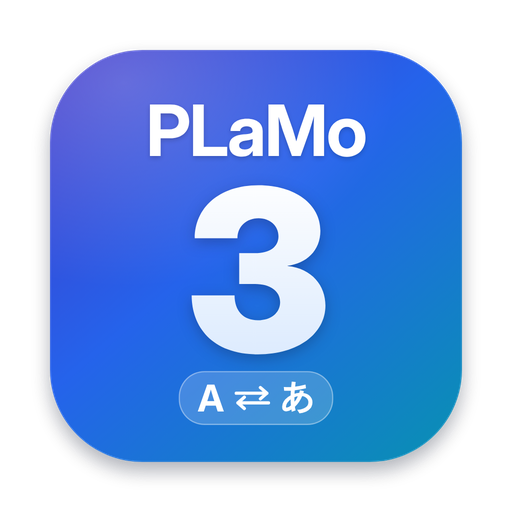

# PLaMo 3 Translate Local

Preferred Networks の翻訳特化 LLM **[PLaMo 3 Translate](https://huggingface.co/pfnet/plamo-3-translate-0.8b-GGUF)** を、
クラウドに送らず **端末内だけで** 動かす翻訳アプリ集です。

| アプリ | ディレクトリ | 推論エンジン | 対応モデル |
| --- | --- | --- | --- |
| iOS / iPadOS | [`apple/`](apple/README.md) | llama.cpp（Metal）XCFramework | 0.8B（既定）/ 2B / 8B※ |
| macOS | [`apple/`](apple/README.md) | llama.cpp（Metal）XCFramework | 0.8B（既定）/ 2B / 8B |
| Google Chrome 拡張機能 | [`chrome-extension/`](chrome-extension/README.md) | **macOS アプリを呼び出す（既定）**。上級者向けに llama-server、実験的にブラウザ内 WASM※※ | 0.8B（既定）/ 2B / 8B（macOS アプリでダウンロードしたもの） |

※ 8B は RAM 8GB 以上の iPhone / iPad を推奨。
※※ npm 最新の wllama 3.8.1（llama.cpp b11364）は PLaMo 3 のトークナイザ（`plamo3`）に未対応のため、現時点ではブラウザ内推論でモデルを読み込めません。wllama が新しい llama.cpp に追従したら依存を更新するだけで有効になります。



## 構成

```
shared/            全アプリ共通の仕様（モデルカタログ・53言語・PFML3 テストベクタ）
apple/
  PlamoTranslateKit/   Swift パッケージ（PFML3 生成・llama.cpp ラッパー・モデル DL）
  App/                 SwiftUI アプリ（iOS / macOS 共通 + 各 OS 固有）
chrome-extension/  Manifest V3 拡張機能（TypeScript）
tools/             テストベクタ・モデルカタログの生成、アプリアイコン（tools/app-icon/make.sh で再生成）
```

## 設計の要点

- **モデル形式は GGUF**。llama.cpp が `plamo3` アーキテクチャにネイティブ対応しており、iOS・macOS・ブラウザ（WASM）で同じファイルを使えます。
  MLX 版は独自の Python モデルコード／トークナイザが前提で iOS やブラウザに持ち込みにくく、0.8B では GGUF Q4_K_M の方が小さく（0.57 GB vs 0.98 GB）精度劣化も小さいため採用していません。
- **モデルサイズは既定 0.8B（Q4_K_M, 0.57 GB）**。設定から 2B（1.81 GB）・8B（5.28 GB）に切り替えられます。量子化（Q4_K_M / Q4_0 / Q3_K_M / Q2_K）も選択可能です。
- **プロンプトは各アプリが PFML3 形式で直接組み立てます**（公式モデルカード推奨の方法）。公式チャットテンプレートから生成したテストベクタ
  [`shared/pfml3-test-vectors.json`](shared/pfml3-test-vectors.json) と完全一致することを各実装のテストで確認します。
- 翻訳オプション：翻訳先 / 翻訳元（省略時は自動判定）/ 常体・敬体 / 用語集 / 参考文脈 / 対訳履歴（直前の段落を渡して訳語・文体を揃える）。
- **Chrome 拡張機能は macOS アプリを翻訳エンジンとして呼び出します**。macOS アプリは起動中 `http://127.0.0.1:18080` に llama-server 互換 API を公開し（既定で有効・外部や一般の Web ページからは接続不可）、
  拡張機能から使用モデル（0.8B / 2B / 8B）も切り替えられます。仕様は [`shared/local-api.md`](shared/local-api.md)。

## ライセンス

- このリポジトリのコード: MIT License
- モデル（ダウンロードして使用）: [PLaMo Community License](https://plamo.preferredai.jp/info/plamo-community-license-ja)。
  個人・非商用利用は登録不要で無償。商用利用は条件付き（売上 10 億円以下は登録フォームで無償、超える場合は別途契約）。
- llama.cpp / wllama: MIT License

## UI

DeepL を参考にした操作感です：左右（iPhone は上下）2 ペイン、入力しながら自動翻訳、言語の自動検出、文体（常体／敬体）、用語集。
macOS では任意のアプリで **⌘C を 2 回** 押すと選択テキストをフローティングウィンドウで翻訳します。Chrome では選択テキスト横のアイコン・右クリック・ページ全体翻訳に対応します。
